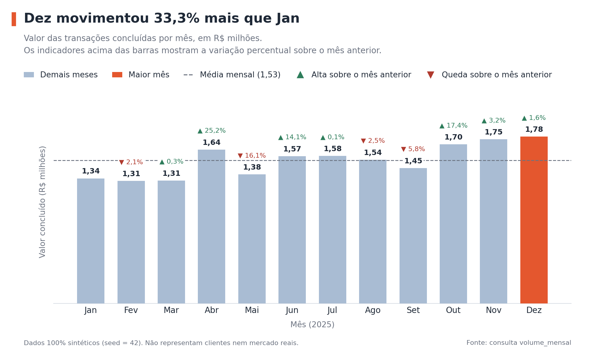
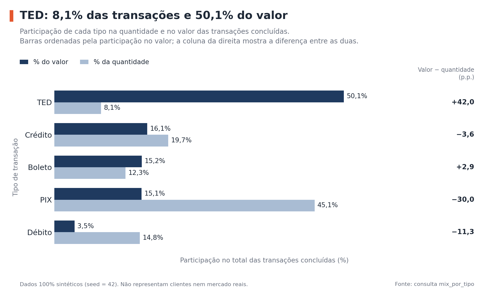
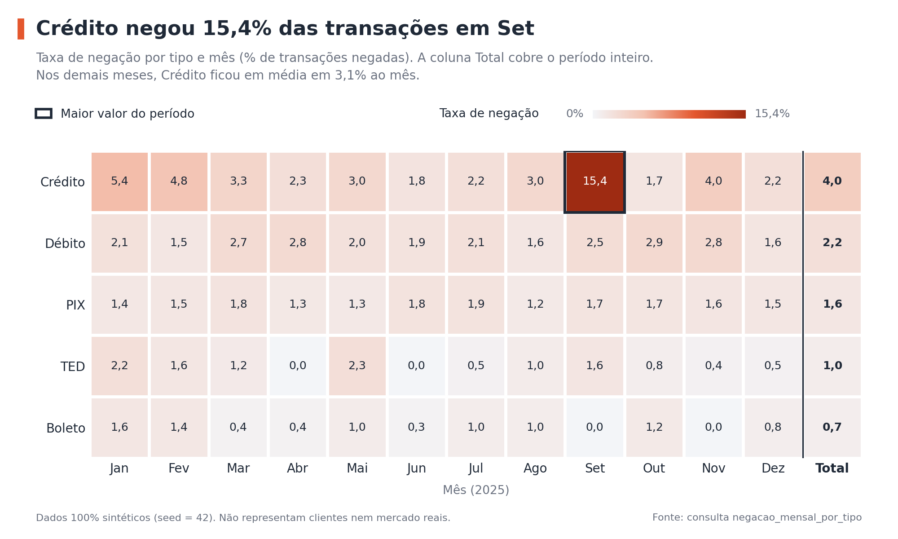

# Banking Analytics: transações bancárias sintéticas com Python e SQLite

> **Os dados deste projeto são 100% sintéticos.** Foram gerados por regras definidas no próprio código (`analise.py`). Não existem clientes, contas, transações ou bancos reais aqui, e os resultados não representam nenhum mercado real.

## O problema

Imagine uma área de produto de um banco **fictício** que precisa responder perguntas simples sobre as transações dos clientes: o volume está crescendo? Quais meios de pagamento movimentam mais dinheiro? Algum tipo de transação passou a ser negado com mais frequência? O valor médio muda entre perfis de clientes? Uma pequena parte dos clientes concentra a maior parte do valor?

Este projeto responde a essas cinco perguntas com **consultas SQL** sobre um banco SQLite, e executa tudo com **um único comando**, gerando tabelas, gráficos e um resumo.

## Como funciona

1. `analise.py` gera dados fictícios de forma reprodutível (mesma *seed*, mesmos dados) e carrega em um banco SQLite local.
2. As consultas de `sql/consultas.sql` são executadas, uma por pergunta de negócio.
3. Os resultados são salvos em CSV, três gráficos são desenhados e um resumo em Markdown é escrito em `resultados/`.

| # | Pergunta de negócio | Consulta | Técnicas SQL utilizadas |
|---|---|---|---|
| 1 | Como evoluem quantidade e valor das transações mês a mês? | `volume_mensal` | CTE, `GROUP BY`, `LAG` |
| 2 | Quanto cada tipo (PIX, TED, boleto, cartão) representa do valor total? | `mix_por_tipo` | `GROUP BY`, função de janela sobre agregação |
| 3 | Quando e onde a taxa de negação foge do normal? | `negacao_mensal_por_tipo` | Agregação condicional (`CASE` dentro de `SUM`) |
| 4 | O valor médio por transação difere entre segmentos de clientes? | `ticket_por_segmento` | `JOIN` de 3 tabelas, `AVG`, `COUNT(DISTINCT)` |
| 5 | Que parcela do valor vem dos 10% de clientes que mais movimentam? | `concentracao_por_decil` | CTEs encadeadas, `NTILE` |

## Resultados de exemplo

Gerados por este projeto com `seed = 42`: 1.000 clientes, 1.195 contas e 30.000 transações (601 negadas). O resumo completo, com todas as tabelas, está em [`resultados/resumo.md`](resultados/resumo.md).





Destaques desta execução (todos válidos apenas para o conjunto sintético):

- O valor mensal das transações concluídas variou entre R$ 1,31 milhão (fevereiro) e R$ 1,78 milhão (dezembro).
- TED responde por 50,1% do valor, com cerca de 8% das transações concluídas.
- A negação no cartão de crédito chegou a 15,42% em setembro, contra uma média de 3,06% nos outros meses.
- Ticket médio: Premium R$ 988,51, Pequena Empresa R$ 839,34, Varejo R$ 392,31.
- Os 10% de clientes que mais movimentam concentram 43,7% do valor concluído.

## Como interpretar os resultados

Como os dados foram **construídos** por regras, parte do que aparece é consequência direta dessas regras, e não uma descoberta:

- **Setembro no cartão de crédito:** o gerador eleva a taxa de negação nesse mês de propósito (3% para 15%). O gráfico mostra que a consulta SQL encontra o padrão, mas isso não é um achado sobre o mundo real. Oscilações menores, como os 5,41% de janeiro no crédito (22 negadas em 407), são acaso estatístico.
- **Variação mensal do valor:** o gerador só embute um crescimento de 3% ao mês no número de transações. Saltos como +25,2% em abril e -16,1% em maio vêm principalmente de poucos TEDs de valor alto, que pesam muito na soma.
- **TED e concentração:** os valores seguem uma distribuição com poucos valores muito grandes (definida no gerador). Por isso TED domina o valor e poucos clientes concentram boa parte dele.
- **Ticket por segmento:** os segmentos têm multiplicadores de valor definidos no gerador (Premium 2,5×, Pequena Empresa 2,0×, Varejo 1,0×).

O objetivo do projeto é mostrar o **método** (perguntas de negócio traduzidas em SQL, execução reproduzível, testes), e não conclusões sobre bancos reais.

## Como executar no Windows

**Requisitos:** Python 3.10 ou superior (instalador de python.org, marcando "Add python.exe to PATH"). Verifique com `python --version`.

No PowerShell, dentro da pasta do projeto:

```powershell
python -m venv .venv
.venv\Scripts\Activate.ps1
pip install -r requirements.txt
python analise.py
python -m pytest
```

- `python analise.py` leva poucos segundos e (re)gera tudo em `resultados/`. O banco SQLite é criado em `dados/banco.db` e pode ser aberto com o *DB Browser for SQLite* (gratuito) ou a extensão SQLite do VS Code.
- Se o PowerShell bloquear a ativação do ambiente virtual, rode uma vez `Set-ExecutionPolicy -Scope CurrentUser RemoteSigned`, ou use o Prompt de Comando (CMD) com `.venv\Scripts\activate.bat`.
- Opções: `python analise.py --seed 7` gera outros dados sintéticos; `--saida` e `--banco` mudam os caminhos de saída.
- Executar de novo com a mesma *seed* reproduz os mesmos resultados.

Ambiente em que o projeto foi testado: Python 3.12, SQLite 3.45, pandas 3.0 e matplotlib 3.10, em Linux.

## Estrutura

```
banking-analytics/
├── analise.py            # script principal: gera dados, roda as consultas, cria gráficos e resumo
├── sql/
│   ├── schema.sql        # tabelas clientes, contas e transacoes
│   └── consultas.sql     # as 5 consultas, uma por pergunta de negócio
├── tests/
│   └── test_analise.py   # 4 testes automatizados
├── resultados/           # exemplo de saída gerado pelo projeto (CSVs, 3 gráficos, resumo.md)
├── requirements.txt
└── pytest.ini
```

## Testes

`python -m pytest` executa quatro testes:

1. A mesma *seed* gera os mesmos dados, e *seeds* diferentes geram dados diferentes.
2. Os dados gerados respeitam as chaves estrangeiras e não têm valores inválidos.
3. A consulta `volume_mensal` bate com um resultado **calculado à mão** em uma base mínima de 5 transações.
4. A execução completa produz todos os arquivos esperados (CSVs, gráficos e resumo).

Os testes não validam a "verdade" dos resultados (os dados são fictícios), e sim que a mecânica funciona e que o SQL calcula o que diz calcular.

## Decisões técnicas

- **SQLite:** vem com o Python, não exige instalação nem serviço externo e suporta CTEs e funções de janela. O dialeto difere de SQL Server ou PostgreSQL (por exemplo, `strftime` aqui, `FORMAT`/`DATEPART` no SQL Server); as consultas precisariam de pequenos ajustes ao migrar.
- **Gerador próprio, sem Faker:** os clientes são apenas identificadores, sem nomes, documentos ou contatos. O gerador usa só `random.random()` para que a mesma *seed* produza os mesmos dados entre versões do Python.
- **Resultados versionados:** a pasta `resultados/` fica no repositório como exemplo de saída. Rodar o projeto a recria.
- **CSVs em `utf-8-sig`:** para o Excel abrir os acentos corretamente. O separador decimal dos CSVs é o ponto.

## Limitações

- Dados sintéticos: nada aqui descreve o comportamento de clientes ou bancos reais.
- O projeto **não** faz detecção de fraude, modelagem preditiva nem recomendação. A análise de negação é descritiva.
- Os valores monetários são armazenados como `REAL` por simplicidade. Em um sistema real, o ideal é usar centavos inteiros ou `DECIMAL`, para evitar erros de arredondamento.
- Cada mês tem poucas centenas de transações por tipo, então taxas mensais oscilam bastante por acaso.
- Não há dashboard, aplicação web nem API. É uma análise em script.

## Sobre o projeto

Projeto de estudo e portfólio de [Max Godoy](https://github.com/maxgodoydev), estudante de Desenvolvimento de Software Multiplataforma na FATEC Zona Sul. Foi desenvolvido com auxílio de IA (Claude, da Anthropic). O código foi executado e testado, mas é material de aprendizado, e não um sistema de produção.
